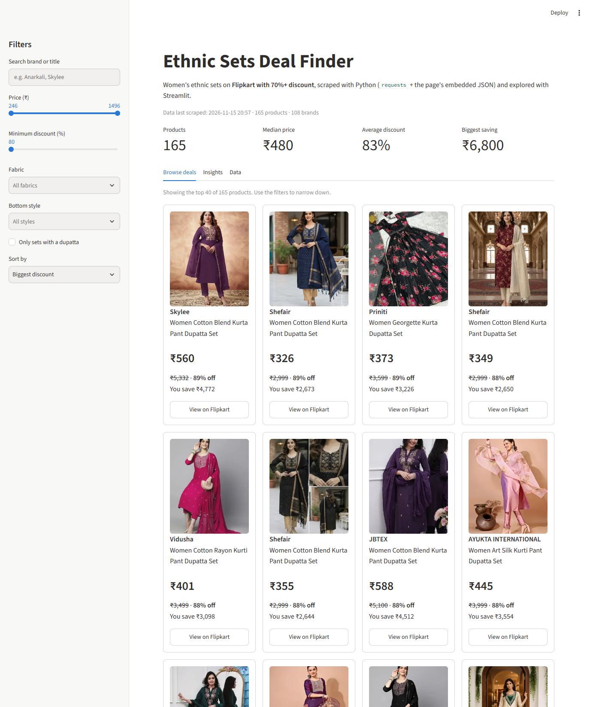

# Ethnic Sets Deal Finder

A web-scraping + data-app project: I scraped **women's ethnic sets with 70%+ discount** from Flipkart
and built an interactive **Streamlit** dashboard to browse and analyse the deals.

**Live app:** _add your Streamlit Cloud link here_



## What it does

- **Browse deals:** product cards with image, price, MRP, discount and a link to Flipkart
- **Filter & sort:** by price, discount, fabric, bottom style (palazzo, salwar, …), dupatta, or free-text search
- **Insights:** price distribution, brands with the most deals, median price by fabric, MRP vs sale price
- **Export:** download the filtered data as CSV

## How it works

```
scraper.py  ──►  products.csv  ──►  app.py (Streamlit)
(run locally)     (the data)         (hosted on Streamlit Cloud)
```

1. **`scraper.py`** downloads 5 result pages with `requests`, using a desktop browser User-Agent.
2. Instead of reading Flipkart's HTML class names (which are auto-generated and change often), it
   extracts the **JSON data embedded in the page** (`window.__INITIAL_STATE__`), which is far more stable.
3. It handles **two different JSON layouts** that Flipkart serves at random, removes duplicate products,
   pauses 2–4 s between requests, and saves a clean CSV.
4. **`app.py`** loads the CSV with `pandas`, derives extra columns (fabric and bottom style parsed from
   the title, ₹ savings), and builds the dashboard with Streamlit + Plotly.

**Why scrape locally instead of inside the app?** Hosted servers often get blocked by large e-commerce
sites. Separating data collection from presentation keeps the app fast and reliable.

## Run it yourself

```bash
python -m venv .venv
.venv\Scripts\activate          # Windows  (macOS/Linux: source .venv/bin/activate)
pip install -r requirements.txt

python scraper.py                # refresh products.csv (optional)
streamlit run app.py             # open http://localhost:8501
```

## Tech stack

Python · requests · JSON parsing · pandas · Plotly · Streamlit

## Note

This project is for learning purposes only. It makes a small number of requests at a slow pace and does
not collect personal data.
